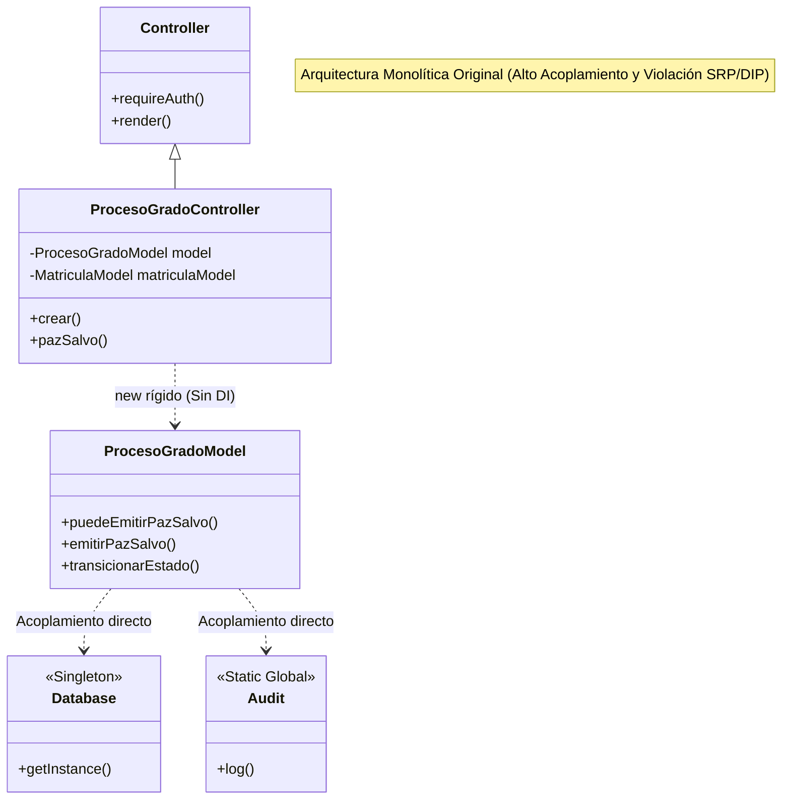
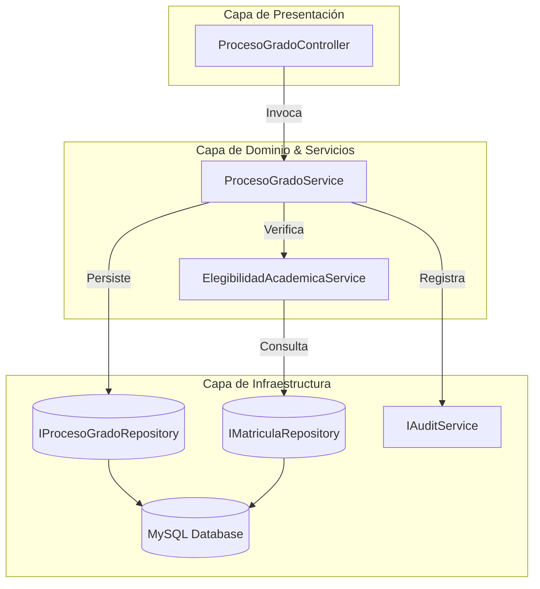

# Auditoría de Calidad (QA) y Arquitectura de Software — SGI-ABS

**Proyecto:** Sistema de Gestión Institucional y Académica (SGI-ABS)  
**Institución:** Institución Educativa ABS (`abs.edu.co`)  
**Versión:** 1.0  
**Evaluadores:** QA Lead Senior & Software Architect  

---

## 1. Matriz de Casos de Prueba Esenciales

Suite de pruebas exhaustiva para verificar las áreas críticas del sistema (Happy Path, Flujos Negativos, Casos Límite y Pruebas de Seguridad).

### Módulo A: Autenticación, Sesión y Control de Acceso (RBAC)

| ID | Tipo | Caso de Prueba | Precondiciones | Entrada / Acción | Resultado Esperado |
| :--- | :--- | :--- | :--- | :--- | :--- |
| **AUTH-01** | *Happy Path* | Login exitoso con credenciales válidas. | Usuario activo con password hash Argon2id/Bcrypt en BD. | `POST /auth/login` con correo y clave correctos + CSRF token. | HTTP 302 hacia `/dashboard`. Sesión iniciada con ID regenerado. Evento `LOGIN_SUCCESS` en auditoría. |
| **AUTH-02** | *Negativo* | Login fallido por contraseña errónea y conteo de intentos. | Usuario existe y se encuentra en estado `ACTIVO`. | `POST /auth/login` con clave incorrecta. | Mensaje de advertencia indicando intentos restantes. Evento `LOGIN_FAILED`. No se regenera la sesión. |
| **AUTH-03** | *Seguridad* | Bloqueo automático por fuerza bruta (Lockout). | Usuario con 4 intentos fallidos previos acumulados. | 5º intento fallido consecutivo. | Estado del usuario transiciona a `BLOQUEADO`. Evento `SECURITY_LOCKOUT`. Posteriores intentos rechazan acceso incluso con clave correcta. |
| **AUTH-04** | *Seguridad* | Prevención de Session Fixation y Cross-Site Scripting. | Sesión anónima previa abierta en el navegador. | Login exitoso. | `session_regenerate_id(true)` ejecutado. Cookie `PHPSESSID` emitida con flags `HttpOnly`, `SameSite=Strict` y `Secure`. |
| **AUTH-05** | *Seguridad* | Violación de RBAC (Horizontal/Vertical). | Sesión iniciada con rol `DOCENTE`. | Intento de acceso forzado a `GET /usuarios/crear`. | HTTP 403 Forbidden. Renderizado de plantilla de error 403 sin filtración de stack trace. |

---

### Módulo B: Motor Académico y Regla de "Estudiante Limpio"

| ID | Tipo | Caso de Prueba | Precondiciones | Entrada / Acción | Resultado Esperado |
| :--- | :--- | :--- | :--- | :--- | :--- |
| **ACAD-01** | *Happy Path* | Detección de Estudiante Elegible (100% malla). | Todas las materias obligatorias con nota $\ge 3.00$ y sin reprobadas vigentes. | Consulta de estado académico en `MatriculaModel::getEstadoAcademico()`. | Retorna estado `LIMPIO`, `materias_pendientes = 0`. Habilita formulario de postulación a práctica. |
| **ACAD-02** | *Negativo / Regla* | Bloqueo de práctica por materia pendiente. | Estudiante tiene 1 materia obligatoria pendiente o reprobada. | Coordinación o Estudiante intenta crear Proceso de Grado. | Sistema bloquea la creación. Muestra materias faltantes. Genera log de auditoría `BLOQUEO_PRACTICA`. |
| **ACAD-03** | *Límite* | Aprobación en Habilitación posterior a reprobación. | Materia reprobada ($nota < 3.00$) con resultado `HABILITACION_PROGRAMADA`. | Registro de resultado de habilitación con nota $3.20$. | La habilitación aprobada invalida la vigencia de la reprobación anterior (`vigente = 0`). El estudiante recupera condición `LIMPIO`. |
| **ACAD-04** | *Integridad* | Prevención de ciclos en prerrequisitos (Anti-autorequisito). | Materia existente con ID $5$. | Intento de asignar materia requisito con ID $5$ a sí misma. | Disparador de BD `trg_materias_no_autorequisito_*` lanza `SQLSTATE 45000`. Transacción abortada. |

---

### Módulo C: Ciclo de Vida del Proceso de Grado y Paz y Salvo

| ID | Tipo | Caso de Prueba | Precondiciones | Entrada / Acción | Resultado Esperado |
| :--- | :--- | :--- | :--- | :--- | :--- |
| **PROC-01** | *Happy Path* | Emisión de Paz y Salvo institucional. | Proceso en `EN_EJECUCION`, 100% horas cumplidas, informe final y bitácoras aprobadas, paz y salvo financiero OK. | Coordinador ejecuta `POST /procesos/pazSalvo`. | Proceso transiciona a `FINALIZADO`. Se genera token SHA-256 inmutable de 12 caracteres. Estado `EMITIDO`. |
| **PROC-02** | *Negativo* | Intento de emisión con evidencias pendientes. | Proceso con 1 bitácora en estado `ENTREGADA` (sin aprobar). | Solicitud de emisión de Paz y Salvo. | Rechazo con código de validación. Lista explícita de faltantes: `"Evidencias requeridas no aprobadas"`. |
| **PROC-03** | *Seguridad* | Revocatoria de Paz y Salvo con justificación obligatoria. | Paz y Salvo en estado `EMITIDO`. | Solicitud `POST /procesos/revocarPazSalvo` con motivo `"Plagio comprobado"`. | Estado cambia a `REVOCADO`. Código anterior queda invalidado para verificación pública. Auditoría registra usuario ejecutor y motivo. |
| **PROC-04** | *Seguridad* | Verificación pública externa de autenticidad. | Código alfanumérico generado en PROC-01. | Consulta anónima en `/procesos/verificar?codigo=...`. | Muestra datos del graduando, programa y fecha de emisión sin requerir login ni exponer datos sensibles (DNI/Teléfono). |

---

### Módulo D: Gestión Segura de Archivos y Evidencias

| ID | Tipo | Caso de Prueba | Precondiciones | Entrada / Acción | Resultado Esperado |
| :--- | :--- | :--- | :--- | :--- | :--- |
| **FILE-01** | *Happy Path* | Subida de informe final en PDF válido. | Proceso activo del estudiante. | Subida de archivo `.pdf` real de 2.5 MB. | Archivo renombrado a `hash_timestamp.pdf`, guardado fuera de `public/`, hash SHA-256 calculado y registrado en tabla `evidencias`. |
| **FILE-02** | *Seguridad* | Detección de MIME Spoofing (Doble extensión). | Estudiante autenticado. | Archivo ejecutable malicioso renombrado a `script.php.pdf`. | `finfo_file` detecta `text/x-php` o `application/x-executable`. Rechazo inmediato. |
| **FILE-03** | *Seguridad* | Prevención de Insecure Direct Object References (IDOR). | Estudiante A autenticado (ID: 6). | Intento de descargar evidencia de Estudiante B: `/evidencias/descargar?id=99`. | Validación de pertenencia contra la matrícula activa. HTTP 403 Forbidden. |
| **FILE-04** | *Seguridad* | Intento de Path Traversal en parámetro `subdir`. | Usuario manipulando petición HTTP. | Envío de `subdir=../../../../etc`. | Filtro de sanitización remueve secuencias `..`. No se permite escapar de `UPLOAD_PATH`. |

---

## 2. Identificación de Violaciones a Principios SOLID y DRY



### A. Violaciones a los Principios SOLID

#### 1. Violación al Principio de Responsabilidad Única (SRP)
* **`BaseModel.php`**: Es a la vez un Data Access Object (ejecutor de sentencias PDO SQL) y el motor de auditoría (`Audit::log` hardcodeado en `create`, `update` y `delete`). Si la estrategia de auditoría cambia (por ejemplo, a Kafka o CloudWatch), hay que modificar el DAO fundamental de la base de datos.
* **`ProcesoGradoModel.php`**: En más de 340 líneas asume múltiples responsabilidades divergentes:
  1. Persistencia CRUD de la tabla `procesos_grado`.
  2. Motor de reglas de negocio de grado (`puedeEmitirPazSalvo`).
  3. Criptografía y emisión de certificados (`bin2hex(random_bytes(6))`).
  4. Máquina de estados de transición académica (`transicionarEstado`).
* **`FileUpload.php`**: Valida peticiones HTTP (`$_FILES`), inspecciona cabeceras binarias MIME, calcula hashes SHA-256, gestiona el sistema de archivos del SO (`mkdir`, `move_uploaded_file`) y despacha descargas HTTP terminando el proceso con `die()`.

#### 2. Violación al Principio Abierto/Cerrado (OCP)
* **Transiciones de Estado rígidas**: Métodos como `ProcesoGradoModel::transicionarEstado` tienen listas cerradas con arrays en código fuente. Para añadir una nueva modalidad (ej: "COTUTELA", "DIPLOMADO") o un nuevo estado ("EN_SUSPENSION_TEMPORAL"), se debe alterar directamente la lógica interna del modelo en lugar de inyectar una estrategia o máquina de estados extensible.
* **Formatos y reglas de validación**: `FileUpload` tiene listas fijas en código. No es posible extender los validadores por tipo de documento sin modificar la clase central.

#### 3. Violación al Principio de Sustitución de Liskov (LSP)
* **`AuditoriaModel.php` vs `BaseModel.php`**:
  `AuditoriaModel` extiende de `BaseModel`. Sin embargo, la auditoría debe ser inmutable (*append-only*). Por ende, `AuditoriaModel` sobrescribe `update()` y `delete()` devolviendo `false` o bloqueando la acción:
  ```php
  // AuditoriaModel.php violando el contrato de la clase padre
  public function update(int $id, array $data): bool { return false; }
  public function delete(int $id): bool { return false; }
  ```
  Un cliente polimórfico que reciba `BaseModel` espera que `update()` actualice el registro; si se le pasa `AuditoriaModel`, el contrato se rompe silenciosamente.

#### 4. Violación al Principio de Segregación de Interfaces (ISP)
* El sistema **no define interfaces (`interface`)**. Todas las clases consumen APIs gigantescas de modelos completos. Por ejemplo, `DashboardController` sólo necesita contar registros y listar 5 procesos, pero está forzado a depender de la totalidad de métodos operativos, destructivos y transaccionales de `ProcesoGradoModel` y `UsuarioModel`.

#### 5. Violación al Principio de Inversión de Dependencias (DIP)
* **Instanciación Rígida (`new`)**: Todos los controladores instancian sus modelos directamente en sus constructores:
  ```php
  public function __construct() {
      $this->model = new ProcesoGradoModel(); // Acoplamiento directo a la implementación
  }
  ```
* **Uso ubicuo de Singletons y Clases Estáticas**: `Database::getInstance()`, `Session::get()`, `Auth::user()`, `Audit::log()`. El código de alto nivel depende directamente de detalles de bajo nivel, impidiendo la inyección de dobles de prueba (mocks/stubs) para pruebas unitarias automatizadas con PHPUnit.

---

### B. Violaciones al Principio DRY (Don't Repeat Yourself)

1. **Chequeo de Autorización y Protección IDOR Duplicado**:
   El bloque para verificar si un estudiante intenta acceder a recursos que no le pertenecen se repite casi idéntico en `EvidenciaController::subir`, `EvidenciaController::descargar`, `ProcesoGradoController::detalle`, y `MatriculaController::detalle`:
   ```php
   // Fragmento repetido en al menos 4 controladores
   if (Auth::role() === ROL_ESTUDIANTE) {
       $matricula = $this->matriculaModel->findByUsuario((int)Auth::id());
       if (!$matricula || (int)$proceso['id_matricula'] !== (int)$matricula['id_matricula']) {
           http_response_code(403);
           include BASE_PATH . '/views/errors/403.php';
           exit;
       }
   }
   ```
2. **Consultas de Enriquecimiento (SQL Duplicado)**:
   Las consultas `SELECT ... JOIN usuarios u ON ... JOIN programas p ON ...` se repiten en `MatriculaModel`, `ProcesoGradoModel` y `EvidenciaModel` con ligeras variaciones de alias, en vez de encapsularse en vistas de base de datos o repositorios reutilizables.
3. **Manejo Idéntico de Errores de Base de Datos**:
   El bloque `catch (PDOException $e) { error_log(...); return []; }` está duplicado más de 25 veces a lo largo de la capa de modelos.

---

## 3. Propuesta de Refactorización Modular (Clean Architecture)



### 3.1. Abstracción e Interfaces (Contratos)

#### `core/Contracts/AuditServiceInterface.php`
```php
<?php
declare(strict_types=1);

namespace App\Core\Contracts;

interface AuditServiceInterface
{
    public function log(
        string $accion,
        string $entidad,
        string $idRegistro,
        ?array $valorAnterior = null,
        ?array $valorNuevo = null,
        string $motivo = ''
    ): void;
}
```

#### `core/Contracts/ProcesoGradoRepositoryInterface.php`
```php
<?php
declare(strict_types=1);

namespace App\Core\Contracts;

interface ProcesoGradoRepositoryInterface
{
    public function findById(int $id): ?array;
    public function findActivoByMatricula(int $idMatricula): ?array;
    public function findDetallados(array $filtros = []): array;
    public function create(array $data): int;
    public function updateEstado(int $id, string $nuevoEstado, ?string $fechaCierre = null): bool;
    public function guardarPazSalvo(int $id, string $codigo, int $emitidoPorId): bool;
    public function anularPazSalvo(int $id, string $motivo, int $revocadoPorId): bool;
}
```

#### `core/Contracts/MatriculaRepositoryInterface.php`
```php
<?php
declare(strict_types=1);

namespace App\Core\Contracts;

interface MatriculaRepositoryInterface
{
    public function findById(int $id): ?array;
    public function findByUsuarioId(int $usuarioId): ?array;
    public function obtenerEstadoAcademico(int $idMatricula): array;
    public function obtenerMateriasPendientes(int $idMatricula): array;
}
```

---

### 3.2. Capa de Servicios de Dominio (Domain Services)

#### `services/ElegibilidadAcademicaService.php`
Encapsula la regla de negocio de "Estudiante Limpio" sin mezclar SQL ni peticiones HTTP.

```php
<?php
declare(strict_types=1);

namespace App\Services;

use App\Core\Contracts\MatriculaRepositoryInterface;

class ElegibilidadAcademicaService
{
    public function __construct(
        private readonly MatriculaRepositoryInterface $matriculaRepo
    ) {}

    /**
     * Evalúa si un estudiante cumple con el 100% de la malla curricular
     * y no presenta materias pendientes ni habilitaciones en curso.
     */
    public function evaluarElegibilidad(int $idMatricula): array
    {
        $estado = $this->matriculaRepo->obtenerEstadoAcademico($idMatricula);
        $pendientes = $this->matriculaRepo->obtenerMateriasPendientes($idMatricula);

        $esLimpio = ($estado['estado_academico'] ?? '') === 'LIMPIO' 
                    && (int)($estado['materias_pendientes'] ?? 0) === 0 
                    && (int)($estado['habilitaciones_en_curso'] ?? 0) === 0;

        return [
            'es_elegible'         => $esLimpio,
            'estado_academico'    => $estado['estado_academico'] ?? 'CON_DEUDA_ACADEMICA',
            'materias_pendientes' => $pendientes,
            'conteo_pendientes'   => count($pendientes),
        ];
    }
}
```

#### `services/ProcesoGradoService.php`
Encapsula el ciclo de vida del proceso de grado, la máquina de estados y la emisión del Paz y Salvo.

```php
<?php
declare(strict_types=1);

namespace App\Services;

use App\Core\Contracts\ProcesoGradoRepositoryInterface;
use App\Core\Contracts\MatriculaRepositoryInterface;
use App\Core\Contracts\AuditServiceInterface;
use DomainException;
use RuntimeException;

class ProcesoGradoService
{
    // Transiciones válidas de la máquina de estados
    private const TRANSICIONES_VALIDAS = [
        'ELEGIBLE'      => ['EN_EJECUCION', 'CANCELADO'],
        'EN_EJECUCION'  => ['FINALIZADO', 'SUSPENDIDO', 'CANCELADO'],
        'SUSPENDIDO'    => ['EN_EJECUCION', 'CANCELADO'],
        'FINALIZADO'    => [], // Estado terminal de práctica
        'CANCELADO'     => [], // Estado terminal definitivo
    ];

    public function __construct(
        private readonly ProcesoGradoRepositoryInterface $procesoRepo,
        private readonly MatriculaRepositoryInterface $matriculaRepo,
        private readonly ElegibilidadAcademicaService $elegibilidadService,
        private readonly AuditServiceInterface $auditService
    ) {}

    /**
     * Inicia un nuevo proceso garantizando la regla de negocio de Estudiante Limpio.
     */
    public function iniciarProceso(array $datos, int $creadorId): int
    {
        $idMatricula = (int)$datos['id_matricula'];
        $evaluacion = $this->elegibilidadService->evaluarElegibilidad($idMatricula);

        if (!$evaluacion['es_elegible']) {
            $this->auditService->log(
                'BLOQUEO_PRACTICA',
                'procesos_grado',
                'N/A',
                null,
                ['id_matricula' => $idMatricula, 'motivo' => 'CON_DEUDA_ACADEMICA'],
                'Rechazo automático: estudiante cuenta con materias pendientes'
            );
            throw new DomainException('El estudiante presenta deuda académica y no es elegible.');
        }

        $existente = $this->procesoRepo->findActivoByMatricula($idMatricula);
        if ($existente !== null) {
            throw new DomainException('La matrícula ya posee un proceso de grado activo.');
        }

        $id = $this->procesoRepo->create($datos);

        $this->auditService->log(
            'CREACION_PROCESO',
            'procesos_grado',
            (string)$id,
            null,
            $datos,
            'Registro inicial de proceso de grado'
        );

        return $id;
    }

    /**
     * Ejecuta la transición de estados validando invariantes de negocio.
     */
    public function transicionar(int $idProceso, string $nuevoEstado, int $usuarioId, string $motivo): void
    {
        $proceso = $this->procesoRepo->findById($idProceso);
        if (!$proceso) {
            throw new DomainException('Proceso de grado no encontrado.');
        }

        $estadoActual = $proceso['estado'];
        $posibles = self::TRANSICIONES_VALIDAS[$estadoActual] ?? [];

        if (!in_array($nuevoEstado, $posibles, true)) {
            throw new DomainException("Transición inválida de '{$estadoActual}' a '{$nuevoEstado}'.");
        }

        $fechaCierre = ($nuevoEstado === 'FINALIZADO' || $nuevoEstado === 'CANCELADO') 
            ? date('Y-m-d H:i:s') 
            : null;

        $ok = $this->procesoRepo->updateEstado($idProceso, $nuevoEstado, $fechaCierre);
        if (!$ok) {
            throw new RuntimeException('No fue posible persistir el cambio de estado.');
        }

        $this->auditService->log(
            'TRANSICION_ESTADO',
            'procesos_grado',
            (string)$idProceso,
            ['estado' => $estadoActual],
            ['estado' => $nuevoEstado],
            $motivo
        );
    }

    /**
     * Valida y emite el Paz y Salvo final con código de verificación criptográfico.
     */
    public function emitirPazSalvo(int $idProceso, int $usuarioId): string
    {
        $proceso = $this->procesoRepo->findById($idProceso);
        if (!$proceso) {
            throw new DomainException('Proceso de grado no encontrado.');
        }

        if (($proceso['paz_salvo_estado'] ?? '') === 'EMITIDO') {
            throw new DomainException('El Paz y Salvo ya se encuentra emitido para este proceso.');
        }

        // Generar código alfanumérico seguro en mayúsculas (ej: ABS-7F2A-91C4)
        $rawBytes = bin2hex(random_bytes(6));
        $codigo = 'ABS-' . strtoupper(substr($rawBytes, 0, 4) . '-' . substr($rawBytes, 4, 4));

        $ok = $this->procesoRepo->guardarPazSalvo($idProceso, $codigo, $usuarioId);
        if (!$ok) {
            throw new RuntimeException('Fallo al almacenar la emisión del Paz y Salvo.');
        }

        $this->auditService->log(
            'EMISION_PAZ_SALVO',
            'procesos_grado',
            (string)$idProceso,
            null,
            ['codigo' => $codigo, 'emitido_por' => $usuarioId],
            'Emisión satisfactoria de Paz y Salvo institucional'
        );

        return $codigo;
    }
}
```

---

### 3.3. Capa de Infraestructura (Persistencia PDO Segura)

#### `repositories/ProcesoGradoRepository.php`
```php
<?php
declare(strict_types=1);

namespace App\Repositories;

use App\Core\Contracts\ProcesoGradoRepositoryInterface;
use PDO;

class ProcesoGradoRepository implements ProcesoGradoRepositoryInterface
{
    public function __construct(private readonly PDO $db) {}

    public function findById(int $id): ?array
    {
        $stmt = $this->db->prepare('SELECT * FROM `procesos_grado` WHERE `id_proceso` = :id LIMIT 1');
        $stmt->execute([':id' => $id]);
        $row = $stmt->fetch(PDO::FETCH_ASSOC);
        return $row !== false ? $row : null;
    }

    public function findActivoByMatricula(int $idMatricula): ?array
    {
        $sql = "SELECT * FROM `procesos_grado` 
                WHERE `id_matricula` = :m 
                  AND `estado` IN ('ELEGIBLE', 'EN_EJECUCION', 'SUSPENDIDO') 
                LIMIT 1";
        $stmt = $this->db->prepare($sql);
        $stmt->execute([':m' => $idMatricula]);
        $row = $stmt->fetch(PDO::FETCH_ASSOC);
        return $row !== false ? $row : null;
    }

    public function findDetallados(array $filtros = []): array
    {
        $sql = "SELECT pg.*, 
                       mt.periodo_ingreso,
                       u.nombres AS estudiante_nombres, u.apellidos AS estudiante_apellidos,
                       u.correo AS estudiante_correo,
                       p.nombre AS programa_nombre
                FROM `procesos_grado` pg
                INNER JOIN `matriculas` mt ON mt.id_matricula = pg.id_matricula
                INNER JOIN `usuarios` u    ON u.id_usuario = mt.id_usuario
                INNER JOIN `programas` p   ON p.id_programa = mt.id_programa";

        $where = [];
        $params = [];
        if (!empty($filtros['estado'])) {
            $where[] = 'pg.estado = :estado';
            $params[':estado'] = $filtros['estado'];
        }

        if ($where) {
            $sql .= ' WHERE ' . implode(' AND ', $where);
        }
        $sql .= ' ORDER BY pg.id_proceso DESC';

        $stmt = $this->db->prepare($sql);
        $stmt->execute($params);
        return $stmt->fetchAll(PDO::FETCH_ASSOC);
    }

    public function create(array $data): int
    {
        $sql = "INSERT INTO `procesos_grado` 
                (`id_matricula`, `modalidad`, `entidad_razon_social`, `titulo_proyecto`, `estado`, `fecha_inicio`) 
                VALUES (:id_matricula, :modalidad, :entidad, :titulo, :estado, :fecha_inicio)";
        $stmt = $this->db->prepare($sql);
        $stmt->execute([
            ':id_matricula' => $data['id_matricula'],
            ':modalidad'    => $data['modalidad'],
            ':entidad'      => $data['entidad_razon_social'] ?? null,
            ':titulo'       => $data['titulo_proyecto'] ?? null,
            ':estado'       => $data['estado'] ?? 'EN_EJECUCION',
            ':fecha_inicio' => $data['fecha_inicio'] ?? date('Y-m-d'),
        ]);
        return (int)$this->db->lastInsertId();
    }

    public function updateEstado(int $id, string $nuevoEstado, ?string $fechaCierre = null): bool
    {
        $sql = 'UPDATE `procesos_grado` SET `estado` = :estado, `fecha_fin` = COALESCE(:fin, `fecha_fin`) WHERE `id_proceso` = :id';
        $stmt = $this->db->prepare($sql);
        return $stmt->execute([
            ':estado' => $nuevoEstado,
            ':fin'    => $fechaCierre,
            ':id'     => $id
        ]);
    }

    public function guardarPazSalvo(int $id, string $codigo, int $emitidoPorId): bool
    {
        $sql = "UPDATE `procesos_grado` 
                SET `paz_salvo_estado` = 'EMITIDO',
                    `paz_salvo_codigo` = :codigo,
                    `paz_salvo_fecha`  = NOW(),
                    `paz_salvo_emitido_por` = :uid,
                    `estado` = 'FINALIZADO'
                WHERE `id_proceso` = :id";
        $stmt = $this->db->prepare($sql);
        return $stmt->execute([':codigo' => $codigo, ':uid' => $emitidoPorId, ':id' => $id]);
    }

    public function anularPazSalvo(int $id, string $motivo, int $revocadoPorId): bool
    {
        $sql = "UPDATE `procesos_grado` 
                SET `paz_salvo_estado` = 'REVOCADO',
                    `paz_salvo_observaciones` = :motivo
                WHERE `id_proceso` = :id";
        $stmt = $this->db->prepare($sql);
        return $stmt->execute([':motivo' => $motivo, ':id' => $id]);
    }
}
```

---

### 3.4. Controlador Delgado (Thin Controller)

```php
<?php
declare(strict_types=1);

namespace App\Controllers;

use App\Services\ProcesoGradoService;
use App\Core\Contracts\ProcesoGradoRepositoryInterface;
use Controller;
use Auth;
use Session;
use DomainException;
use Throwable;

class ProcesoGradoController extends Controller
{
    public function __construct(
        private readonly ProcesoGradoService $procesoService,
        private readonly ProcesoGradoRepositoryInterface $procesoRepo
    ) {}

    public function index(): void
    {
        $this->requireAuth();
        $filtros = [];

        if (Auth::role() === ROL_ESTUDIANTE) {
            $this->redirectTo('dashboard');
        }

        $estado = (string)$this->getQuery('estado', '');
        if ($estado !== '') {
            $filtros['estado'] = $estado;
        }

        $this->render('procesos/index', [
            'title'    => 'Procesos de Grado',
            'procesos' => $this->procesoRepo->findDetallados($filtros),
            'filtros'  => $filtros,
        ]);
    }

    public function emitirPazSalvo(): void
    {
        $this->requireRole([ROL_COORDINACION, ROL_ADMIN]);
        $this->validateCsrf();

        $id = (int)$this->getPost('id', 0);

        try {
            $codigo = $this->procesoService->emitirPazSalvo($id, (int)Auth::id());
            Session::setFlash('success', "Paz y Salvo emitido con éxito. Código de verificación: {$codigo}");
        } catch (DomainException $de) {
            Session::setFlash('error', $de->getMessage());
        } catch (Throwable $e) {
            error_log("[ProcesoGradoController::emitirPazSalvo] {$e->getMessage()}");
            Session::setFlash('error', 'Ocurrió un error inesperado al procesar la solicitud.');
        }

        $this->redirectTo('procesos', 'detalle', ['id' => $id]);
    }
}
```
