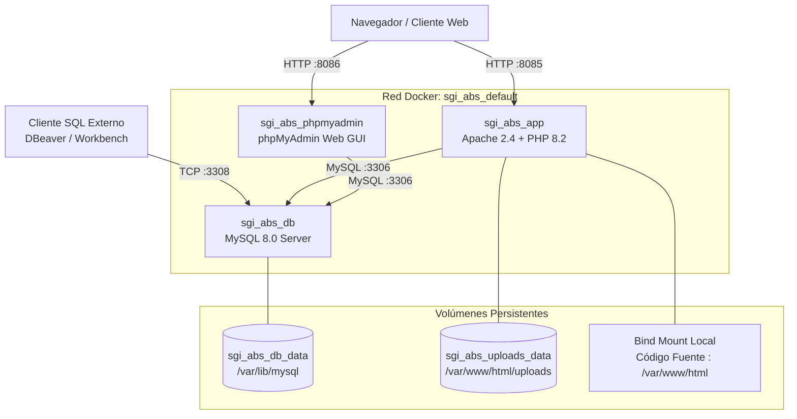

# Manual de Despliegue e Infraestructura — SGI-ABS

**Sistema de Gestión Institucional y Académica (SGI-ABS)**  
**Institución Educativa ABS** · `abs.edu.co`  
Versión: 1.0 · Contenedores Docker · MySQL 8.0 · PHP 8.2 Apache  

---

## 1. Arquitectura de Despliegue

La infraestructura de SGI-ABS está orquestada con **Docker Compose**, compuesta por 3 servicios aislados que se comunican a través de una red interna bridge dedicada:



### Componentes de la Infraestructura

1. **`app` (`sgi_abs_app`)**:
   - Base: `php:8.2-apache`.
   - Extensiones instaladas y habilitadas: `pdo_mysql`, `gd`, `zip`, `mbstring`, `fileinfo`.
   - Módulos Apache activos: `rewrite`, `headers`.
   - DocumentRoot configurado en: `/var/www/html/public`.
   - Composer integrado (`composer:2`).
   - Manejo de ciclo de vida con script `docker/docker-entrypoint.sh`.
2. **`db` (`sgi_abs_db`)**:
   - Imagen: `mysql:8.0`.
   - Autenticación: `mysql_native_password`.
   - Charset y Collation: `utf8mb4` / `utf8mb4_unicode_ci`.
   - Verificación de salud integrada (`healthcheck`) con `mysqladmin ping`.
   - Volumen de persistencia: `sgi_abs_db_data`.
3. **`phpmyadmin` (`sgi_abs_phpmyadmin`)**:
   - Interfaz web para administración visual de la base de datos MySQL.

---

## 2. Requisitos Previos del Servidor / Host

- **Sistema Operativo:** Linux (Ubuntu 20.04+, Debian 11+, Arch, RHEL), macOS o Windows con WSL2.
- **Docker Engine:** Versión 20.10.0 o superior.
- **Docker Compose:** Plugin v2.0+ (`docker compose`).
- **Puertos Disponibles en el Host:**
  - `8085` (Aplicación Web SGI-ABS).
  - `8086` (phpMyAdmin).
  - `3308` (Conexión externa a MySQL).

---

## 3. Despliegue Rápido Paso a Paso

### Paso 1 — Clonar o ubicar el proyecto
```bash
cd /ruta/hacia/sgi_abs
```

### Paso 2 — Configurar el archivo de entorno (`.env`)
Copie el archivo de ejemplo si no existe `.env`:
```bash
cp .env.example .env
```

Contenido predeterminado de `.env`:
```ini
# Puertos expuestos en el host local
APP_PORT=8085
DB_PORT_EXTERNAL=3308
PMA_PORT=8086

# Configuración de Base de Datos MySQL
DB_NAME=sgi_abs
DB_USER=root
DB_PASSWORD=root_password
DB_ROOT_PASSWORD=root_password
```

### Paso 3 — Construir e inicializar los contenedores
Ejecute el comando de construcción y arranque en segundo plano:
```bash
docker compose up -d --build
```

### Paso 4 — Verificación del arranque automático
El contenedor de la aplicación espera automáticamente a que MySQL esté saludable (`healthy`), comprueba si la base de datos existe y ejecuta el aprovisionamiento de esquema y semillas en su primer arranque.

Para verificar los logs de inicialización:
```bash
docker logs -f sgi_abs_app
```

Salida esperada:
```
=================================================
   SGI-ABS — Inicializando contenedor de App     
=================================================
[1/3] Verificando conexion con base de datos (db:3306)...
[OK] Conexion con el servidor MySQL establecida.
[2/3] Verificando estado del esquema de la base de datos...
  -> Base de datos no encontrada o sin tablas. Ejecutando aprovisionamiento automatico (setup.php)...
[OK] Tablas e índices creados exitosamente.
[OK] Disparadores de integridad de materias registrados.
[OK] Datos iniciales insertados en la base de datos.
[OK] Aprovisionamiento inicial completado con exito.
[3/3] Dependencias listas.
=================================================
   SGI-ABS listo y en ejecucion                  
=================================================
```

### Paso 5 — Validar servicios activos
```bash
docker compose ps
```
Todos los servicios deben figurar con estado `Up` y `db` como `Up (healthy)`.

---

## 4. URLs de Acceso y Credenciales

| Servicio | URL / Host | Credenciales Predeterminadas |
| :--- | :--- | :--- |
| **SGI-ABS Web** | [http://localhost:8085](http://localhost:8085) | `admin@abs.edu.co` / `Admin2026!` |
| **phpMyAdmin** | [http://localhost:8086](http://localhost:8086) | Usuario: `root` / Clave: `root_password` |
| **MySQL Externo** | `localhost:3308` | Servidor: `localhost`, Puerto: `3308`, BD: `sgi_abs` |

---

## 5. Mantenimiento y Operaciones

### 5.1. Detener e Iniciar Servicios
- **Detener los servicios sin borrar datos:**
  ```bash
  docker compose stop
  ```
- **Iniciar servicios existentes:**
  ```bash
  docker compose start
  ```
- **Bajar contenedores manteniendo los volúmenes intactos:**
  ```bash
  docker compose down
  ```

### 5.2. Copias de Seguridad (Backups)

#### Respaldo de Base de Datos MySQL (Dump)
Ejecute el volcado lógico desde el contenedor:
```bash
docker exec sgi_abs_db mysqldump -u root -proot_password sgi_abs > backup_sgi_abs_$(date +%Y%m%d_%H%M%S).sql
```

#### Restauración de Base de Datos
```bash
docker exec -i sgi_abs_db mysql -u root -proot_password sgi_abs < backup_sgi_abs_YYYYMMDD_HHMMSS.sql
```

#### Respaldo de Archivos y Evidencias (`uploads/`)
Dado que las evidencias se almacenan en el volumen `sgi_abs_uploads_data`:
```bash
docker run --rm \
  -v sgi_abs_uploads_data:/data:ro \
  -v $(pwd):/backup \
  alpine tar -czvf /backup/backup_uploads_$(date +%Y%m%d_%H%M%S).tar.gz -C /data .
```

### 5.3. Reinicio Limpio Total (Reset de Base de Datos)
Si requiere reiniciar por completo el sistema desde cero eliminando todos los datos:
```bash
docker compose down -v
docker compose up -d
```
> [!CAUTION]
> La opción `-v` destruye permanentemente los volúmenes de MySQL y Uploads. Úselo únicamente en entornos de desarrollo o pruebas.

---

## 6. Recomendaciones para Puesta en Producción

Para migrar esta infraestructura a un entorno productivo en la nube (AWS EC2, DigitalOcean, Hetzner, etc.):

1. **Proxy Inverso con Certificados SSL/TLS (HTTPS):**
   - Coloque un servidor Nginx o Traefik frente al contenedor de la aplicación.
   - Configure certificados SSL gratuitos y automatizados mediante Let's Encrypt (Certbot).
2. **Cierre de Puertos Expuestos:**
   - En `docker-compose.yml`, elimine el bloque `ports:` del servicio `db` para que el puerto `3306` sea accesible **únicamente dentro de la red interna Docker**.
   - Desactive o proteja mediante autenticación básica HTTP el servicio `phpmyadmin`, o desmóntelo en producción comentando su bloque.
3. **Rotación de Secretos y Contraseñas:**
   - Genere contraseñas criptográficas complejas (mínimo 24 caracteres) para `MYSQL_ROOT_PASSWORD` en el archivo `.env`.
   - Modifique los hashes de los usuarios administrativos de prueba.
4. **Almacenamiento de Subidas:**
   - Para entornos multi-servidor o de alta disponibilidad, configure el almacenamiento de `uploads/` sobre un bucket compatible con S3 (AWS S3, Cloudflare R2, MinIO).
