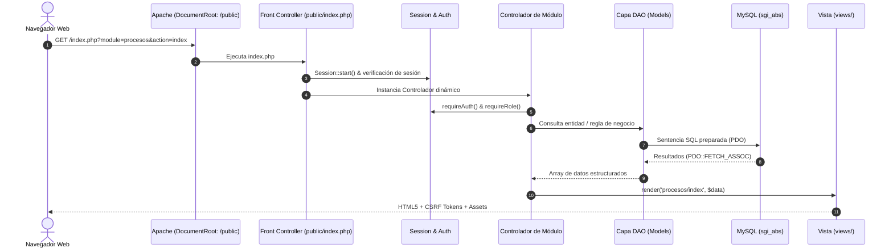
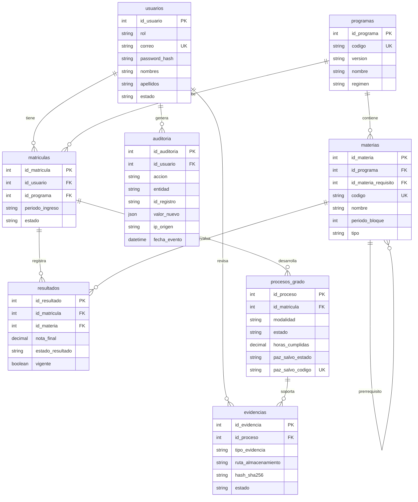

# Manual Técnico de Arquitectura y Desarrollo — SGI-ABS

**Sistema de Gestión Institucional y Académica (SGI-ABS)**  
**Institución Educativa ABS** · `abs.edu.co`  
Versión: 1.0 · PHP 8.2+ · MySQL 8.0+ / MariaDB 10.6+ · Docker  

---

## 1. Visión General del Sistema

SGI-ABS es una plataforma web desarrollada para la gestión del avance académico, control de prerequisitos curriculares y seguimiento integral del proceso de prácticas formativas y de grado para programas técnicos laborales y tecnológicos.

### Stack Tecnológico

| Capa | Componente | Versión / Detalle |
| :--- | :--- | :--- |
| **Lenguaje Backend** | PHP | 8.2+ (Modo estricto `declare(strict_types=1)`) |
| **Servidor Web** | Apache HTTP Server | 2.4 con `mod_rewrite` y `mod_headers` |
| **Base de Datos** | MySQL Server | 8.0+ (Motor InnoDB, Charset `utf8mb4_unicode_ci`) |
| **Gestión de Paquetes** | Composer | 2.x (`phpoffice/phpspreadsheet`, `phpunit`) |
| **Frontend UI** | HTML5 / CSS3 / Vanilla JS | Bootstrap 5.3.2, Bootstrap Icons 1.11, DataTables 1.13 |
| **Contenedores** | Docker & Docker Compose | Multi-container (`app`, `db`, `phpmyadmin`) |

---

## 2. Arquitectura de Software

El sistema implementa una arquitectura desacoplada basada en el patrón **MVC (Modelo-Vista-Controlador)** con una capa **DAO (Data Access Object)** especializada y servicios transversales de seguridad.

```
sgi_abs/
├── config/             # Configuración global y singleton de conexión PDO
│   ├── config.php      # Constantes, roles, parámetros de subida, autoloader
│   └── database.php    # Clase Database (Singleton PDO y lectura de entorno)
├── core/               # Núcleo del framework personalizado
│   ├── Auth.php        # Autenticación, bloqueo por fuerza bruta, RBAC
│   ├── Audit.php       # Servicio de auditoría inmutable
│   ├── Controller.php  # Controlador base (CSRF, render, redirect, sanitización)
│   ├── Database.php    # Wrapper de acceso a datos
│   ├── FileUpload.php  # Gestión de subida y descarga segura + hash SHA-256
│   └── Session.php     # Abstracción de sesiones seguras
├── models/             # Capa DAO (Data Access Objects)
│   ├── BaseModel.php   # DAO genérico con operaciones CRUD y auditoría
│   ├── AuditoriaModel.php
│   ├── EvidenciaModel.php
│   ├── MateriaModel.php
│   ├── MatriculaModel.php
│   ├── ProcesoGradoModel.php
│   ├── ProgramaModel.php
│   ├── ResultadoModel.php
│   └── UsuarioModel.php
├── controllers/        # Controladores de orquestación HTTP (11 módulos)
├── views/              # Plantillas PHP limpias divididas por módulo
├── public/             # Raíz web pública (DocumentRoot de Apache)
│   ├── index.php       # Front Controller
│   ├── .htaccess       # Reglas de reescritura hacia index.php
│   └── assets/         # Recursos estáticos (CSS, JS, imágenes)
├── uploads/            # Almacenamiento seguro fuera de la raíz pública
├── sql/                # Esquemas DDL, semillas y scripts de aprovisionamiento
└── docker/             # Configuración Apache, PHP y Entrypoint de arranque
```

### Flujo de Ejecución (Front Controller Pattern)



---

## 3. Modelo de Datos y Esquema Relacional

El esquema está normalizado en Tercera Forma Normal (3FN), compuesto por 8 tablas relacionales, 2 vistas de evaluación curricular en tiempo real y disparadores de integridad.

### Diagrama Entidad-Relación (DER)



### Vistas SQL de Evaluación Curricular

1. **`v_materias_pendientes`**: Identifica dinámicamente las materias obligatorias de la malla inscrita que el estudiante aún no ha aprobado con nota $\ge 3.00$ o que se encuentran reprobadas.
2. **`v_estado_academico`**: Agrupa el conteo de materias pendientes y habilitaciones en curso por matrícula. Define de manera determinística el estado:
   - **`LIMPIO`**: $0$ materias pendientes y $0$ habilitaciones en curso.
   - **`CON_DEUDA_ACADEMICA`**: $> 0$ materias pendientes o habilitaciones pendientes.

### Disparadores (Triggers) de Integridad
- **`trg_materias_no_autorequisito_ins`** y **`trg_materias_no_autorequisito_upd`**: Disparadores `BEFORE INSERT` y `BEFORE UPDATE` en la tabla `materias`. Impiden a nivel de motor de base de datos que una asignatura se establezca como su propio prerrequisito curricular, lanzando una excepción `SQLSTATE 45000`.

---

## 4. Núcleo del Sistema (Core)

### `Auth.php`
- Gestiona el inicio de sesión contra hashes seguros.
- Implementa bloqueo por fuerza bruta: acumula intentos fallidos en sesión por cada cuenta de usuario; tras 5 intentos fallidos, actualiza el estado del usuario en la base de datos a `BLOQUEADO` y registra una alerta en auditoría.
- Al autenticar con éxito, llama a `Session::regenerate(true)` para destruir el identificador de sesión anterior y mitigar ataques de fijación de sesión.
- Control de roles mediante `Auth::can($roles)`.

### `Audit.php`
- Servicio de auditoría estática append-only.
- Registra usuario ejecutor, acción, entidad afectada, ID de registro, snapshot JSON del estado previo y posterior, IP de origen (`REMOTE_ADDR`) y timestamp.

### `FileUpload.php`
- **Subida de Archivos:**
  1. Verifica el código de error nativo de PHP (`UPLOAD_ERR_OK`).
  2. Limita el tamaño a máximo 10MB (`MAX_UPLOAD_BYTES`).
  3. Valida extensiones autorizadas (`pdf`, `docx`, `jpg`, `png`, `xlsx`).
  4. Inspección binaria mediante `finfo(FILEINFO_MIME_TYPE)` para evitar MIME Spoofing.
  5. Cálculo del hash criptográfico SHA-256 (`hash_file('sha256', ...)`).
  6. Guarda el archivo fuera de la raíz web en `uploads/[subcarpeta]/[hash]_[time].[ext]`.
- **Descarga Controlada:**
  - Método `download()` que envía cabeceras `Content-Type`, `Content-Disposition: attachment` y transmite el archivo mediante buffers seguros `readfile()`.

### `Controller.php`
- Provee utilidades `requireAuth()`, `requireRole()`, `validateCsrf()`, `json()`, `render()` y `redirectTo()`.
- Generación de tokens CSRF con entropía criptográfica (`random_bytes(32)`) y validación en tiempo constante con `hash_equals()`.

---

## 5. Control de Acceso y Roles (RBAC)

La plataforma cuenta con 6 roles jerárquicos:

| Rol | Constante | Permisos Principales |
| :--- | :--- | :--- |
| **Administrador** | `ROL_ADMIN` | Gestión total de usuarios, asignación de roles, programas, mallas, auditoría del sistema y configuraciones. |
| **Registro Académico** | `ROL_REGISTRO` | Gestión de matrículas, inscripción de programas, registro masivo de resultados académicos y notas. |
| **Coordinación** | `ROL_COORDINACION` | Aprobación de planes de estudio, apertura de procesos de grado a estudiantes limpios, emisión y revocatoria de Paz y Salvo. |
| **Docente** | `ROL_DOCENTE` | Consulta de asignaturas asignadas, ingreso y corrección de calificaciones numéricas. |
| **Resp. Prácticas** | `ROL_PRACTICAS` | Seguimiento a procesos en ejecución, revisión y calificación de bitácoras e informes de práctica. |
| **Estudiante** | `ROL_ESTUDIANTE` | Consulta de avance de malla, materias pendientes, postulación a práctica y carga de evidencias. |

---

## 6. Prácticas de Seguridad Implementadas

1. **Defensa en Profundidad contra IDOR**:
   Los endpoints que reciben identificadores por parámetro (ej. `/evidencias/descargar?id=12` o `/procesos/detalle?id=5`) validan explícitamente en el backend si el usuario autenticado tiene rol administrativo o si el ID del recurso pertenece a su matrícula activa.
2. **Protección Contra SQL Injection**:
   100% de las consultas utilizan sentencias preparadas PDO con paso de parámetros tipados (`:param`). Ninguna variable externa se concatena directamente en sentencias DML.
3. **Protección contra XSS (Cross-Site Scripting)**:
   Todas las salidas dinámicas en vistas PHP se escapan con `htmlspecialchars($val, ENT_QUOTES, 'UTF-8')`.
4. **Protección de Cabeceras HTTP**:
   El servidor Apache inyecta de forma obligatoria:
   - `X-Frame-Options: SAMEORIGIN` (Anti-Clickjacking).
   - `X-Content-Type-Options: nosniff` (Anti-MIME Sniffing).
   - `Referrer-Policy: strict-origin-when-cross-origin`.
   - `Permissions-Policy: camera=(), microphone=(), geolocation=()`.
