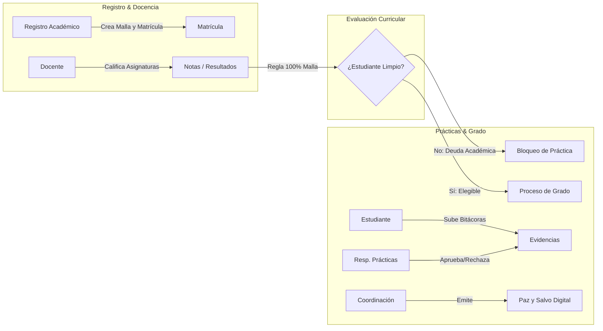

# Manual de Usuario del Sistema SGI-ABS

**Sistema de Gestión Institucional y Académica (SGI-ABS)**  
**Institución Educativa ABS** · `abs.edu.co`  
Versión: 1.0  

---

## 1. Introducción

El **SGI-ABS** es la plataforma institucional diseñada para gestionar de forma transparente, segura y automatizada el avance curricular de los estudiantes, la postulación y seguimiento de las prácticas formativas/laborales y la emisión final del **Paz y Salvo de Grado**.

El sistema garantiza que **ningún estudiante pueda acceder a la etapa práctica sin haber aprobado previamente el 100% de las asignaturas obligatorias** de su malla curricular (Regla institucional del *"Estudiante Limpio"*).

---

## 2. Acceso al Sistema

### 2.1. Inicio de Sesión
1. Abra su navegador web e ingrese a la dirección: [**http://localhost:8085**](http://localhost:8085)
2. Ingrese su **Correo Institucional** y su **Contraseña**.
3. Haga clic en el botón **Ingresar al Sistema**.

> [!WARNING]
> **Política de Bloqueo por Seguridad:**  
> Si se introducen credenciales incorrectas **5 veces consecutivas**, la cuenta quedará automáticamente **BLOQUEADA** para protegerla contra ataques de fuerza bruta. Deberá comunicarse con el Administrador para su desbloqueo.

### 2.2. Usuarios de Prueba Disponibles

| Rol Institucional | Correo Electrónico | Contraseña Predeterminada |
| :--- | :--- | :--- |
| **Administrador Principal** | `admin@abs.edu.co` | `Admin2026!` |
| **Registro Académico** | `registro@abs.edu.co` | `Registro2026!` |
| **Coordinador Académico** | `coordinacion@abs.edu.co` | `Coord2026!` |
| **Docente** | `docente@abs.edu.co` | `Docente2026!` |
| **Resp. de Prácticas** | `practicas@abs.edu.co` | `Practicas2026!` |
| **Estudiante** | `estudiante@abs.edu.co` | `Estudiante2026!` |

---

## 3. Funcionalidades por Rol

---

### 3.1. Rol: Administrador Principal

El Administrador tiene el control total de la configuración y seguridad de la plataforma.

1. **Panel de Control (Dashboard):**
   - Visualiza en tiempo real las métricas institucionales: Total de Usuarios, Programas activos, Matrículas registradas y Procesos en curso.
   - Monitorea el **Registro de Actividad Reciente del Sistema**.
2. **Gestión de Usuarios (`Módulo Usuarios`):**
   - **Crear Usuario:** Permite dar de alta a nuevos docentes, estudiantes, coordinadores o administrativos.
   - **Editar Perfil:** Modificar nombres, apellidos, documento de identidad y rol.
   - **Cambiar Estado:** Activar, Inactivar o Desbloquear cuentas bloqueadas tras intentos fallidos.
3. **Auditoría del Sistema (`Módulo Auditoría`):**
   - Registro inmutable de cada acción ejecutada en el sistema (Login, Creación, Actualización, Eliminación, Bloqueo de práctica).
   - Búsqueda avanzada por fechas, usuario responsable, acción y tabla afectada.

---

### 3.2. Rol: Registro Académico

Encargado de la estructura curricular de la institución y el registro de calificaciones.

1. **Gestión de Programas y Mallas (`Módulo Programas`):**
   - Registrar programas técnicos con su código, nombre, versión y régimen (SENA / Institucional).
2. **Gestión de Materias (`Módulo Materias`):**
   - Definir asignaturas, intensidad horaria, bloque/semestre y materias prerrequisito.
   - El sistema impide automáticamente que una materia sea prerrequisito de sí misma.
3. **Gestión de Matrículas (`Módulo Matrículas`):**
   - Vincular a un estudiante con un programa académico en un periodo determinado (ej. `2026-1`).
4. **Registro de Calificaciones (`Módulo Resultados`):**
   - Asentar notas numéricas en escala de `0.00` a `5.00`.
   - La nota mínima de aprobación es **`3.00`**.
   - En caso de reprobación, permite programar habilitaciones; una vez aprobada la habilitación, el sistema actualiza automáticamente la condición académica del estudiante.

---

### 3.3. Rol: Docente

1. **Gestión de Notas:**
   - Visualizar las asignaturas a su cargo y los estudiantes matriculados.
   - Asentar calificaciones finales y emitir observaciones pedagógicas.

---

### 3.4. Rol: Estudiante

1. **Estado Académico y Avance de Malla:**
   - **Indicador de Avance:** Barra de progreso porcentual del cumplimiento de su programa académico.
   - **Insignia de Estado:**
     - `LIMPIO`: Ha aprobado el 100% de las asignaturas obligatorias y no presenta deudas académicas.
     - `CON DEUDA ACADÉMICA`: Tiene una o más materias reprobadas o pendientes de cursar.
   - **Tabla de Materias Pendientes:** Muestra exactamente cuáles asignaturas faltan por aprobar.
2. **Mi Proceso de Práctica:**
   - Si su estado es `LIMPIO`, puede visualizar su postulación o solicitar la apertura de su proceso.
   - Si presenta deuda académica, el sistema desactiva el botón de postulación e informa las materias requeridas.
3. **Carga de Evidencias y Bitácoras (`Módulo Evidencias`):**
   - Subir reportes de actividades, informes mensuales, cartas de cumplimiento y soportes de ARL.
   - Formatos permitidos: **PDF, DOCX, XLSX, JPG, PNG** (Tamaño máximo: 10 MB).
   - Seguimiento del estado de revisión de sus evidencias (`PENDIENTE`, `EN REVISIÓN`, `APROBADA`, `RECHAZADA`).
4. **Paz y Salvo de Grado:**
   - Una vez finalizada la práctica y aprobadas todas las evidencias, puede visualizar su constancia digital de Paz y Salvo.

---

### 3.5. Rol: Responsable de Prácticas

1. **Seguimiento a Estudiantes en Práctica:**
   - Listado de procesos en estado `EN EJECUCIÓN`.
   - Control de horas acumuladas de práctica laboral o proyecto productivo.
2. **Revisión de Evidencias:**
   - Bandeja de entrada de bitácoras e informes entregados por los estudiantes.
   - Descarga segura de archivos con verificación de integridad SHA-256.
   - **Aprobar:** Avala la evidencia y suma cumplimiento al estudiante.
   - **Rechazar:** Requiere ingresar observaciones obligatorias para que el estudiante reenvíe una nueva versión corregida.

---

### 3.6. Rol: Coordinación Académica

1. **Apertura de Procesos de Grado:**
   - Autorizar la modalidad de práctica (Pasantía, Contrato de Aprendizaje, Vínculo Laboral, Proyecto Productivo).
   - Si intenta abrir un proceso para un estudiante con materias pendientes, el sistema **bloquea la operación** de forma inmediata.
2. **Emisión de Paz y Salvo Institucional:**
   - Verifica los 4 requisitos indispensables:
     1. 100% de asignaturas aprobadas (Estado `LIMPIO`).
     2. 100% de horas de práctica cumplidas.
     3. Totalidad de evidencias y bitácoras en estado `APROBADA`.
     4. Paz y salvo financiero verificado.
   - Al emitir el Paz y Salvo, el sistema genera un **Código Único de Verificación** inmutable (ejemplo: `ABS-4B8E-91C2`).
3. **Revocatoria de Paz y Salvo:**
   - En caso de fraude o inconsistencia comprobada, Coordinación puede anular el documento ingresando un motivo formal que queda asentado en la auditoría del sistema.

---

## 4. Módulo Público de Verificación de Paz y Salvo

Para certificar la autenticidad de los certificados emitidos sin comprometer la privacidad:

1. Cualquier persona, empresa receptora o entidad evaluadora puede ingresar a:  
   `http://localhost:8085/index.php?module=procesos&action=verificar`
2. Digite el código alfanumérico que figura en el documento físico o digital (ej: `ABS-4B8E-91C2`).
3. El sistema responderá inmediatamente:
   - ✅ **DOCUMENTO VÁLIDO:** Indica nombre del graduando, programa técnico cursado, fecha y hora exacta de emisión.
   - ❌ **DOCUMENTO NO VÁLIDO / REVOCADO:** Advierte si el código no existe o si fue anulado por la coordinación académica.

---

## 5. Preguntas Frecuentes (FAQ)

### ¿Por qué el estudiante no puede registrar su práctica si ya aprobó casi todas las materias?
La reglamentación de la Institución Educativa ABS exige el cumplimiento estricto del **100% de la malla curricular**. Si existe una sola materia pendiente o en proceso de habilitación, el sistema bloquea automáticamente la creación del proceso de grado.

### ¿Qué ocurre si un archivo subido es rechazado por el revisor?
El estudiante recibirá el estado `RECHAZADA` junto con los comentarios del revisor. El estudiante podrá realizar una nueva entrega (incrementando la versión a `v2`, `v3`, etc.) adjuntando el documento corregido.

### ¿Se pueden eliminar registros de auditoría?
No. El registro de auditoría es **inmutable (append-only)**. Ni siquiera el usuario Administrador puede modificar o eliminar eventos históricos de la base de datos.
